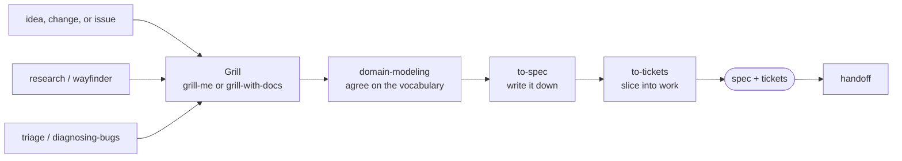
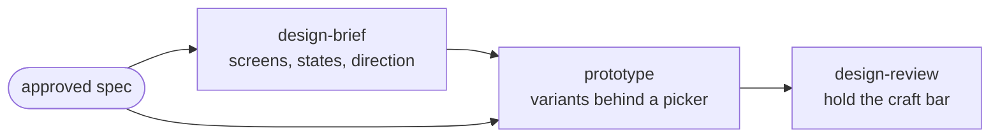
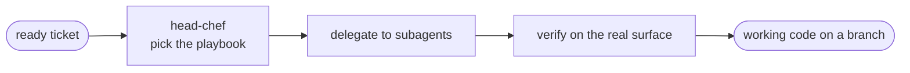
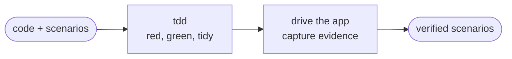
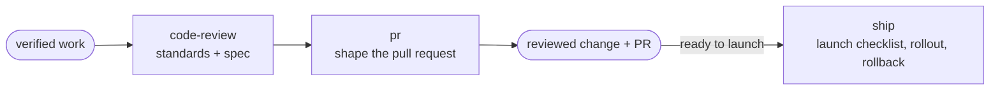

# Skills

> Agent skills for building software you can trust: understand what to build, build it well, and prove it works.

`npx skills add NickDabizaz/skills`

---

## The idea

Two rooms of a Michelin restaurant.

**The dining room knows the guest.** Before anyone cooks, the restaurant learns who is coming, what they need, and what a great result looks like. Planning asks the hard questions early and turns the answers into a spec and tickets.

**The kitchen sends out one excellent plate.** The head chef already knows the dish from the dining room. The chef does not improvise. They delegate each part to a specialist, hold the quality bar, and prove the plate is right before it leaves.

Design is the plating: a brief says what to make, a prototype shows it, and both are held to a craft bar.

The result is two abilities: knowing what to build, and building it in a way you can trust without reading every line.

## The five stages

| Stage | You bring | It produces |
| --- | --- | --- |
| 1. Planning | an idea, a change, or an incoming issue | a spec and tickets |
| 2. Design | an approved spec | a design brief and/or a prototype |
| 3. Development | a ready ticket | working code on a branch |
| 4. Testing | code and agreed scenarios | verified scenarios with evidence |
| 5. Review and commit | verified work | a reviewed change and a PR |

`head-chef` runs one ticket at a time. `ship-project` chains all five stages from a single project description, with the agent as PM.

## Start here

- `ask-me` picks the right next step when you are unsure where to start.
- `head-chef` runs the kitchen: it takes a ticket and executes it with delegation and verification.
- `ship-project` runs the whole lifecycle from one project description, with the agent as PM and the human at only two gates: the spec and the deploy.

Two example flows, plus the whole-project run:

```text
idea -> grilling -> to-spec -> to-tickets -> head-chef -> code-review -> commit -> ship
idea -> to-spec -> design-brief -> prototype -> to-tickets -> head-chef
project description -> ship-project -> (Gate 1: spec) -> design + dev + verify -> (Gate 2: deploy) -> ship
```

## Stage by stage

### 1. Planning: know what to build

You bring: an idea, a change, or an incoming issue. It produces: a spec and tickets.

Planning asks the hard questions early, so the kitchen never has to guess. Questions come first, the spec second, tickets last.



Skills: `grilling`, `grill-me`, `grill-with-docs`, `domain-modeling`, `to-spec`, `to-tickets`, `wayfinder`, `research`, `triage`, `diagnosing-bugs`, `handoff`, `codebase-design`, `to-questionnaire`

Output lives in your workspace, as `spec.md` and a `tickets/` folder. See [Workspace and files](#workspace-and-files).

### 2. Design: the plating

You bring: an approved spec. It produces: a design brief, a prototype, or both.

A brief says what to make; a prototype shows it. The line between them is flexible. Stop at the brief and design by hand, or continue to a prototype the agent builds. Both are held to the same craft bar, and both live inside your workspace.



Skills: `design-brief`, `prototype`, `design-review`

Output lives in your workspace: the brief at `.workspace/design/<feature>/brief.md`, and the prototype at `.workspace/prototype/<topic>/index.html`.

### 3. Development: the head chef

You bring: a ready ticket. It produces: working code on a branch.

The head chef already knows the dish from planning, so it does not improvise. It picks the right playbook, delegates the parts to specialists, and verifies on the real surface before calling it done. The support skills it reaches for, like sketch-first design, parallel candidates, and adversarial review, are called automatically as the work needs them.



Skills: `head-chef`

### 4. Testing: evidence over claims

You bring: code and the agreed scenarios. It produces: verified scenarios with evidence.

A test is an artifact, not a claim. Where a test fits, it is written first and watched to fail before it passes. Where it does not, a project-local way to drive the app proves the behavior on the real surface, and any number you report is checked before you trust it.



Skills: `tdd`, `create-verification-skill`, `maintain-verification-skill`, `benchmark-checklist`, `blast-radius`

### 5. Review and commit: the pass

You bring: verified work. It produces: a reviewed change and a PR.

Before the plate leaves, a reviewer checks the change against the spec and the repo's standards, the evidence is stated plainly, and the change is committed with a pull request that tells a reviewer why it exists and how it was proven.



Skills: `code-review`

When the change is ready to go live, `ship` prepares the launch: the pre-launch checklist, monitoring, a staged rollout, and a rollback plan.

## Skills

**Entry**

| Skill | What it does |
| --- | --- |
| `ask-me` | Routes your situation to the next skill. |
| `setup` | Configures a repository once: trackers, vocabulary, defaults. |
| `ship-project` | Runs a whole project from one description, with the agent as PM, and hands back for deploy. |

**Planning**

| Skill | What it does |
| --- | --- |
| `grilling` | The core interview that sharpens a plan until it is clear. |
| `grill-me` | A quick, stateless grilling pass. |
| `grill-with-docs` | Grilling that also writes the domain docs and spec. |
| `domain-modeling` | Keeps terms, invariants, and decisions consistent. |
| `to-spec` | Turns a settled conversation into a spec. |
| `to-tickets` | Slices a spec into work items with blocking edges. |
| `wayfinder` | Plans work too big for one session as a map of decisions. |
| `research` | Investigates a question against primary sources, with cited notes. |
| `triage` | Classifies an incoming issue and verifies its claim. |
| `diagnosing-bugs` | Finds a bug's root cause and a regression scenario. |
| `handoff` | Compacts the conversation for another session. |
| `codebase-design` | Shared vocabulary for deep, well-seamed modules. |
| `to-questionnaire` | Turns a decision into a questionnaire for someone else. |
| `writing-for-agents` | How to write skills and agent-facing docs. |

**Design**

| Skill | What it does |
| --- | --- |
| `design-brief` | Writes the brief: screens, states, direction, motion intent. |
| `prototype` | Builds an interactive prototype, variants behind a picker or one. |
| `design-review` | Reviews UI and motion, finds gaps, audits, stress-tests data. |

**Execution**

| Skill | What it does |
| --- | --- |
| `head-chef` | The execution mode; routes to playbooks and delegates. |
| `architect` | Sketches interfaces before code, exploring alternatives. |
| `arena` | Runs competing candidates, picks a base, grafts the best. |
| `swarm` | Fans out parallel workers for coverage or races. |
| `interrogate` | Adversarial multi-model review of a change. |
| `how` | Explains how a subsystem works. |
| `why` | Reconstructs why something is the way it is. |
| `teach` | Explains work until the person understands. |
| `recall` | Rebuilds your recent working context as a brief. |
| `figure-it-out` | Designs a bespoke, auditable workflow when no playbook fits. |
| `create-verification-skill` | Generates a project-local way to drive the app. |
| `maintain-verification-skill` | Keeps that verification honest over time. |
| `show-me-your-work` | Keeps a reviewable decision trail. |
| `benchmark-checklist` | Vets a number before you act on it. |
| `blast-radius` | Finds what a change could break, beyond the diff. |
| `correct` | Turns repeated mistakes into structural guards. |
| `reflect` | Reviews a session and routes learnings into skills. |
| `no-comments` | Keeps only the comments that earn their place. |
| `unslop` | Removes AI writing tells from prose. |
| `technical-writing` | A layered standard for docs, PRs, and commit messages. |
| `bro` | Restates the last message in plain language. |

**Testing**

| Skill | What it does |
| --- | --- |
| `tdd` | Test-first: red-green for features, regression-first for bugs. |

**Review, commit, and launch**

| Skill | What it does |
| --- | --- |
| `code-review` | Reviews a change on standards and spec axes. |
| `pr` | Shapes the pull request body around evidence. |
| `retro` | Runs a retrospective and proposes environment improvements. |
| `improve-codebase-architecture` | Scans for structural improvements. |
| `ship` | Prepares a production launch: checklist, monitoring, rollout, rollback. |

## Principles

Principles are small skills you read on demand. `head-chef` cites the ones it applies.

**Engineering:** `principle-prove-it-works`, `principle-sequence-verifiable-units`, `principle-test-behavior-not-implementation`, `principle-fix-root-causes`, `principle-explain-the-number`, `principle-model-the-domain`, `principle-boundary-discipline`, `principle-type-system-discipline`, `principle-separate-before-serializing-shared-state`, `principle-make-operations-idempotent`, `principle-migrate-callers-then-delete-legacy-apis`, `principle-laziness-protocol`, `principle-subtract-before-you-add`, `principle-minimize-reader-load`, `principle-outcome-oriented-execution`, `principle-foundational-thinking`, `principle-redesign-from-first-principles`, `principle-attack-the-premise`, `principle-experience-first`, `principle-exhaust-the-design-space`, `principle-build-the-lever`, `principle-guard-the-context-window`, `principle-never-block-on-the-human`, `principle-encode-lessons-in-structure`.

**Design:** `principle-motion-decision`, `principle-fluid-interfaces`, `principle-ui-craft`, `principle-worst-case-data`, `principle-mobile-native`.

## Workspace and files

- Specs, tickets, and project notes live in your workspace, in `.workspace/`, unless a hosted tracker is chosen.
- Design briefs live in the workspace at `.workspace/design/<feature>/brief.md`.
- Prototypes live in the workspace at `.workspace/prototype/<topic>/index.html`, self-contained and openable in a browser.
- Tracker choice: local Markdown, or a hosted tracker such as GitHub Issues.
- All skill instructions and identifiers are English. Project prose follows the user's language.

## Install and choose skills

- The installer lets you pick skills and the target agent.
- A selective install still needs the supporting skills its entry points call.

## Where this comes from

Three open, MIT licensed sources, adapted into one workflow:

- **Planning and workflow ideas:** Matt Pocock (`mattpocock/skills`).
- **Execution and verification ideas:** pstack by Lauren Tan (poteto) (`cursor/plugins`).
- **Design and motion craft:** Emil Kowalski (`emilkowalski/skills`).

Each source keeps its copyright notice. See [LICENSE](LICENSE).

## Repository layout

```text
skills/<name>/
  SKILL.md
  agents/openai.yaml
```

## Contribution

Add or change a skill in `skills/`, keep its `SKILL.md` and `agents/openai.yaml` consistent, and update the routing table in `ask-me` and this README when the user-facing set changes. No commit or push is performed automatically by these skills.

## License

MIT. See [LICENSE](LICENSE).
