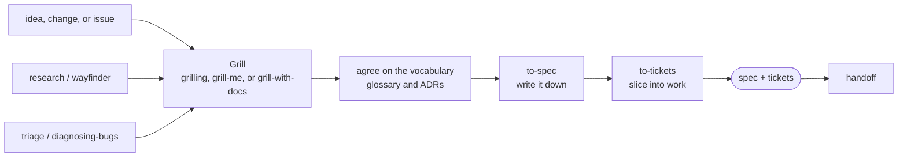

# Skills

> Agent skills for building software you can trust: understand what to build, build it well, and prove it works.

`npx skills add NickDabizaz/skills`

---

## The idea

Two rooms of a Michelin restaurant.

**The dining room knows the guest.** Before anyone cooks, the restaurant learns who is coming, what they need, and what a great result looks like. Planning asks the hard questions early and turns the answers into a spec and tickets.

**The kitchen sends out one excellent plate.** The head chef already knows the dish from the dining room. The chef does not improvise. They delegate each part to a specialist, hold the quality bar, and prove the plate is right before it leaves.

Design is the plating: a brief says what to make, a prototype shows it, and both are held to a craft bar.

The result is two abilities: knowing what to build, and building it in a way you can trust without reading every line.

## The five stages

| Stage | You bring | It produces |
| --- | --- | --- |
| 1. Planning | an idea, a change, or an incoming issue | a spec and tickets |
| 2. Design | an approved spec | a design brief and/or a prototype |
| 3. Development | a ready ticket | working code on a branch |
| 4. Testing | code and agreed scenarios | verified scenarios with evidence |
| 5. Review and commit | verified work | a reviewed change and a PR |

`head-chef` runs one ticket at a time. `ship-project` chains all five stages from a single project description, with the agent as PM.

## Start here

| Skill | What it mainly does |
| --- | --- |
| `ask-me` | Reads your project state and recommends the single next skill. It never runs it for you. |
| `setup` | One-time repo configuration: issue tracker, triage labels, domain doc layout, and the model or role choices the other skills read. |
| `head-chef` | The execution mode. Takes a ticket, picks a playbook, delegates to subagents, and proves the result before it ships. |
| `ship-project` | Runs the whole lifecycle from one project description, with the agent as PM. You approve only two gates: the spec and the deploy. |

Two example flows, plus the whole-project run:

```text
idea -> grilling -> to-spec -> to-tickets -> head-chef -> code-review -> commit -> ship
idea -> to-spec -> design-brief -> prototype -> to-tickets -> head-chef
project description -> ship-project -> (Gate 1: spec) -> design + dev + verify -> (Gate 2: deploy) -> ship
```

## How skills get invoked

Every skill in this package is one of two kinds.

| Kind | Who starts it | Where it is listed |
| --- | --- | --- |
| **User-invoked** | You, on purpose, by typing its name or `/name`. | [Stage by stage](#stage-by-stage), [Start here](#start-here), [Anytime skills](#anytime-skills) |
| **Model-invoked** | `head-chef` or another skill, automatically, when the work needs it. | [Support skills](#support-skills), [Playbooks](#playbooks), [Principles](#principles) |

The stage tables below list only user-invoked skills. Model-invoked does not mean locked: you can still type any of them by name.

## Stage by stage

### 1. Planning: know what to build

You bring: an idea, a change, or an incoming issue. It produces: a spec and tickets.

Planning asks the hard questions early, so the kitchen never has to guess. Questions come first, the spec second, tickets last.



| Skill | What it mainly does |
| --- | --- |
| `grilling` | The core interview. Walks a tree of decisions in rounds, asks every open question with a recommended answer, and stops only when nothing is left assumed. `grill-me` and `grill-with-docs` call it. |
| `grill-me` | A quick grilling pass. Sharpens a plan or design in conversation and writes nothing to disk. |
| `grill-with-docs` | Grilling that also builds the domain model as you talk: it writes the glossary and ADRs the moment a term or decision settles. |
| `to-spec` | Turns the conversation you already had into a spec (problem, solution, user stories, test seams) and publishes it to the tracker. No interview, only synthesis. |
| `to-tickets` | Slices a spec or plan into tracer-bullet tickets. Each is a thin vertical slice that can be verified alone, with explicit blocking edges. |
| `wayfinder` | For work too big for one session. Charts a map of decision tickets on the tracker and resolves them one at a time until the way is clear. |
| `research` | Starts a background agent that checks a question against primary sources and saves cited findings as a Markdown file in the repo. |
| `triage` | Moves incoming issues and external PRs through triage states: categorize, verify the claim, grill if needed, then write an agent-ready brief. |
| `diagnosing-bugs` | A disciplined loop for hard bugs and regressions. Build a tight pass/fail feedback loop first, then reproduce, hypothesise, instrument, fix, and add a regression test. |
| `handoff` | Compacts the conversation into a handoff document so a fresh agent can continue, with suggested skills for the next session. |
| `to-questionnaire` | Turns a decision you cannot answer alone into a questionnaire for someone else. It interviews you only about who it goes to and what you need back. |

Output lives in your workspace, as `spec.md` and a `tickets/` folder. See [Workspace and files](#workspace-and-files).

### 2. Design: the plating

You bring: an approved spec. It produces: a design brief, a prototype, or both.

A brief says what to make; a prototype shows it. The line between them is flexible. Stop at the brief and design by hand, or continue to a prototype the agent builds. Both are held to the same craft bar, and both live inside your workspace.


| Skill | What it mainly does |
| --- | --- |
| `design-brief` | Turns an approved spec into a brief: screens and states, layout regions, content inventory, interactions, visual direction, motion intent, and the accessibility path. |
| `prototype` | Builds an interactive prototype. Explore mode makes 3 to 5 genuinely different variants behind a picker. Build mode makes one, closer to production quality. |
| `design-review` | Reviews UI and motion against the craft bar. Four modes: review, opportunities (find missing motion), audit (whole codebase plan), and stress (worst-case data). Read-only unless asked to fix. |

Output lives in your workspace: the brief at `.workspace/design/<feature>/brief.md`, and the prototype at `.workspace/prototype/<topic>/index.html`.

### 3. Development: the head chef

You bring: a ready ticket. It produces: working code on a branch.

The head chef already knows the dish from planning, so it does not improvise. It picks the right [playbook](#playbooks), delegates the parts to specialists, and verifies on the real surface before calling it done. The [support skills](#support-skills) it reaches for, like sketch-first design, parallel candidates, and adversarial review, are called automatically as the work needs them, and the [principles](#principles) it applies are named in its reply.


| Skill | What it mainly does |
| --- | --- |
| `head-chef` | Runs one ticket like a kitchen. Matches it to a playbook, delegates each part to a subagent with a scope and success criteria, reviews every diff itself, and proves the result before it ships. |

### 4. Testing: evidence over claims

You bring: code and the agreed scenarios. It produces: verified scenarios with evidence.

A test is an artifact, not a claim. Where a test fits, it is written first and watched to fail before it passes. Where it does not, a project-local way to drive the app proves the behavior on the real surface, and any number you report is checked before you trust it.


| Skill | What it mainly does |
| --- | --- |
| `tdd` | Test-first development. A red, green, tidy loop for features at agreed seams, and a regression-first loop for bugs so the failing test lands before the fix. |
| `create-verification-skill` | Generates a project-local skill that drives your real app the way a user does (UI, CLI, or service) and captures evidence. |
| `maintain-verification-skill` | A periodic pass that keeps that verification skill and its feature map honest, ending in at most one PR of proven corrections. |
| `blast-radius` | Finds what a change could break beyond the diff, then proves the one or two facts its safety depends on by running real code instead of writing it up. |

### 5. Review and commit: the pass

You bring: verified work. It produces: a reviewed change and a PR.

Before the plate leaves, a reviewer checks the change against the spec and the repo's standards, the evidence is stated plainly, and the change is committed with a pull request that tells a reviewer why it exists and how it was proven.


| Skill | What it mainly does |
| --- | --- |
| `code-review` | Reviews the changes since a fixed point on two axes, Standards and Spec, in parallel sub-agents, and reports them side by side. |
| `pr` | Shapes the PR body around evidence: a summary, before and after proof, and a merge-danger note (one-way or two-way door, blast radius). |
| `ship` | Prepares a production launch: the pre-launch checklist, monitoring, a staged rollout, and a rollback plan. |

## Anytime skills

User-invoked skills that are not tied to one stage. Reach for them whenever the moment calls for it.

| Skill | What it mainly does |
| --- | --- |
| `how` | Explains how a subsystem works: architecture, runtime flow, and where things live. Also answers "where should this live?" questions. |
| `why` | Reconstructs why something is the way it is, by querying source control, the tracker, docs, chat, and observability in parallel, and returns a cited read. |
| `teach` | Runs `how` and `why`, then weaves the findings into one explanation, until you actually understand the work. |
| `recall` | Rebuilds your recent working context from chat history, live state, and shared records, and hands back a short current-state brief. |
| `bro` | Restates the last message in plain language, with no jargon. |
| `improve-codebase-architecture` | Scans a codebase for deepening opportunities, shows them as a visual HTML report, then grills you through the one you pick. |
| `correct` | Finds the mistakes agents keep repeating in this repo and makes each one structurally impossible: architecture first, then types, lint, tests, and docs last. |
| `reflect` | Spawns three parallel reviewers over the session transcript and routes each learning into a concrete edit of an existing skill. |
| `retro` | Runs a retrospective on a coding session and proposes improvements to the agent's environment: navigation pointers, automated checks, coding standards, and `AGENTS.md`. |

## Support skills

Model-invoked. `head-chef` and other skills call these automatically, so you rarely need to name them. They are listed here so nothing in the package is a mystery.

| Skill | What it mainly does | Called when |
| --- | --- | --- |
| `architect` | Sketches types, signatures, and module structure with unimplemented bodies, synthesizes several model perspectives, then stays in the loop while code fills in. | Code crosses a function boundary. |
| `arena` | Runs N parallel candidates at one task, picks the strongest as the base, and grafts the best parts of the others into it. | Design or code bakeoffs where several shapes are valid. |
| `swarm` | Fans out N parallel workers (slices, races, gauntlets), drains them, and returns one aggregated report. | Parallel coverage, races, and exploration. |
| `interrogate` | Adversarial review by several models with the same rubric. Returns a synthesized verdict and applies nothing. | A contested design, before shipping. |
| `figure-it-out` | Designs a bespoke, auditable workflow with a hypothesis loop and a decision trail. | No playbook fits, such as a large migration. |
| `show-me-your-work` | Keeps a reviewable decision trail as a TSV, one row per decision: what, why, evidence, result. | Long, autonomous, or unattended work. |
| `benchmark-checklist` | Vets a perf measurement (limiter, tuning, errors, repeatability, relevance, and whether the work happened) before you act on it. | You report a speedup or regression you measured. |
| `domain-modeling` | Builds and sharpens the domain model: challenges terms, invents edge cases, and writes `GLOSSARY.md` and ADRs. | Terminology or decisions get settled, for example inside `grill-with-docs`. |
| `codebase-design` | Shared vocabulary for deep modules: module, interface, seam, adapter, and the leverage they give. | Designing or restructuring code. |
| `unslop` | Strips AI writing tells from prose and keeps the meaning and tone. | Any prose surface, including the reply itself. |
| `technical-writing` | A layered standard for docs, PRs, and commit messages: Diátaxis structure, Google developer style, STE rules, and Global English. | Docs, readmes, PR descriptions, commit messages. |
| `no-comments` | Spawns a comment reviewer over the diff, fixes accepted findings, and keeps only comments that earn their place. | Before review. |
| `wizard` | Generates an interactive bash wizard that walks a human through steps only they can do, such as credentials, dashboards, and cutovers. | A procedure needs a human's hands. |
| `writing-for-agents` | The standard for writing skills, `AGENTS.md`, and other agent-facing documents. | Creating or editing a skill or `CLAUDE.md`. |

## Playbooks

A playbook is the step list `head-chef` follows for one kind of task. `head-chef` matches your ticket to a playbook, copies its steps into a todo list verbatim, and ends every playbook with a reply in a fixed shape. A large or cross-cutting effort routes to `figure-it-out` instead, and a standing project-scale program routes to Orchestrate.

Playbooks are model-invoked. The files live in `skills/head-chef/playbooks/`.

### Understand first

Read-only work. The output is a cited answer, not a code change.

| Playbook | Use when | Main points |
| --- | --- | --- |
| **Investigation** | A read-only question: how does X work, why was Y built this way, should we do X or Y. | • Routes through `how`, plus `why` for motivation<br>• Output is a cited explanation, or a recommendation with a tradeoffs table<br>• No PR, no babysit, no code change<br>• Pushes back when the premise is wrong |
| **Runtime forensics** | A live symptom: a leak, an idle CPU spin, a visual glitch. | • Capture a real artifact first: CPU profile, heap snapshot, or trace<br>• Reduce it to the smoking gun in a subagent<br>• Prove the mechanism with live instrumentation before believing it<br>• Map it to file, symbol, and line. The deliverable is a diagnosis, not a fix |
| **Trace forensics** | A capture already exists: a cpuprofile, heap snapshot, or spindump. | • Load it into sqlite so it is queryable before you read it<br>• Narrow to the hot path, or the retainer chain for a leak<br>• Attribute to source. A frame with no source mapping is not a diagnosis<br>• Without a paired capture, report a hypothesis, not a confirmed cause |
| **Session pickup** | Resuming or taking over another agent's in-flight work. | • Read the prior trail (transcript, cloud agent, or branch) and treat it as authoritative<br>• Rebuild state: branch, what landed, open todos, decisions<br>• Diff done against pending and name the resume point. Do not redo work<br>• Verify inherited claims on the real artifact, not on a prior self-report |

### Fix and improve

| Playbook | Use when | Main points |
| --- | --- | --- |
| **Bug fix** | A reported defect to reproduce, root-cause, and fix. | • Reproduce it yourself on the real surface first<br>• Binary-search the cause with runtime evidence, never guess<br>• Ship the smallest change the evidence justifies. A guard that "might help" is a hypothesis, not a fix<br>• The failing repro lands before the fix in git history |
| **Perf issue** | A measured slowness to trace and improve. | • Capture a baseline trace and vet it with `benchmark-checklist`<br>• Try the performance mantras cheapest first: don't do it, don't repeat it, do less, do it later, do it unseen, do it concurrently, do it cheaper<br>• Capture a post-fix trace and compare<br>• Cite the measurement in the PR |
| **Hillclimb** | Sustained improvement of one metric against a target. | • Fix one metric, a direction, and a stop predicate with a floor on iterations<br>• Build the measurement harness, prove its sensitivity, then freeze it<br>• One change, one measurement, keep or revert, logged in `decision.tsv`<br>• Push past plateaus. Correctness and simplicity outrank the number |

### Build and change

| Playbook | Use when | Main points |
| --- | --- | --- |
| **Feature** | New or changed behavior. | • `how` over the subsystem, then `architect` for design exploration<br>• A four-item throughput checkpoint: blocking first steps, independent workstreams, shared mutable state, smallest safe decomposition<br>• Delegate code with a named data shape, or use `arena` when several shapes are valid<br>• Verify on the matching surface, then rebase into small ordered commits |
| **Refactoring** | A behavior-preserving change to structure. | • Pin the behavior contract first with a characterization test or equivalence harness<br>• Name the missing structure and the target shape<br>• Subtract before you add, and migrate callers and delete the old API in one wave<br>• Success means lower reader load. If it does not drop, revert |
| **Prototype** | A throwaway sketch to settle a design or behavior decision. | • Speed over polish: no tests, no abstractions, no production code<br>• No decision to make means no prototype, so route to Feature<br>• Compare alternatives behind one switcher<br>• The observation is the test. Output is the decision plus a throwaway artifact |
| **Visual parity** | Pixel-exact UI equivalence between two implementations. | • Baseline harness comes first. No baseline, no parity claim<br>• Anti-shortcut rules: no harness edits, no baseline tampering, no restructuring to pass a diff<br>• Migrate one component at a time, shared primitives first<br>• Image diff must be zero, not "looks the same" |

### Skills and experiments

| Playbook | Use when | Main points |
| --- | --- | --- |
| **Authoring a skill** | Writing or editing a `SKILL.md`. | • Validate frontmatter, referenced files, and cross-skill links<br>• When in doubt, delete. Keep only prose that changes a decision<br>• Point at structure instead of restating it<br>• A workflow you keep hitting that is not captured becomes a new skill |
| **Eval** | Testing how a skill, structure, or prompt change affects agent behavior. | • Blind the candidates: no words like eval, judge, or rubric where they can see<br>• One organic prompt, N candidates on different models<br>• One blinded judge on a different model family<br>• Grade chain-following from transcripts and code shape, never self-report. Read every output yourself |

### Land the work

| Playbook | Use when | Main points |
| --- | --- | --- |
| **Opening a PR** | The end of every other playbook. | • Work in a worktree and rebase into small, ordered commits<br>• Conventional Commits titles, with `/deslop`, `/no-comments`, `/technical-writing`, and `/unslop` applied<br>• Body sections in order: Why, What changed, Scope, Tradeoffs, Blast Radius, Verification<br>• Open ready, never draft. Prefer five narrow PRs to one large one |
| **Babysit** | "Babysit this", "get it green", "check on PR X". | • Declare a mode first: drive, background, threads-only, or check<br>• Work only the merge frontier, the lowest unmerged PR<br>• Order is conflicts, then review threads, then CI. One retry for a flake, never more<br>• Triage bot comments skeptically. Never mutate stack topology, and never merge |
| **Shipping** | Landing a green stack. | • Green CI is not a verdict. Each PR gets an independent verdict from an agent that did not write it<br>• Land only the contiguous verified run from the bottom, and stop at the ceiling<br>• Re-check that each verdict still describes the patch, using the patch-id<br>• Land one PR at a time and recompute after every merge |

### Run at scale

| Playbook | Use when | Main points |
| --- | --- | --- |
| **Autonomous run** | A long task to drive to completion without stopping. | • State the exit condition as a checkable predicate before the first iteration<br>• Wake on events with a watcher, and use a heartbeat only as fallback<br>• Smallest change per iteration. Revert what did not help<br>• A plateau is not a stop, and the predicate is never relaxed to claim victory |
| **Autopilot-full** | A queue of independent changes to run to merged. | • One owner per PR runs the whole lifecycle from build to merge<br>• The root only verifies: nothing merges without a clean swarm verdict<br>• An hourly audit tick replaces stuck lanes<br>• Operator-named items stop at merge-ready, and a stop order halts every owner at once |
| **Autopilot-stack** | A queue built and verified with full autonomy, delivered for review. | • The same owner loop as Autopilot-full, but no owner merges<br>• The root is the only writer of stack topology<br>• Verified PRs are appended to one linear stack, and drift is absorbed at the root<br>• The operator reviews and lands the chain |
| **Orchestrate** | A standing project handed to one coordinator: multi-day, dozens to hundreds of subagents. | • The coordinator never writes code. The brief is the product<br>• State lives in tables (units, ledger, frontier, gates), and completions are queue events<br>• Pilot one unit before any fan-out, then run a rolling worker window<br>• Verdicts are keyed by PR plus head SHA. Only irreversible actions and real product calls reach the human |
| **Multi-phase plan** | Work that spans phases or several PRs, where the plan is the deliverable. | • Plan only, no implementation<br>• Settle open questions by prototype first<br>• A fixed skeleton, one section per PR: Files, Build, You see, Verify unit, live, and perf, then Merge<br>• Checked by `check-plan.mjs`, and execution starts on the operator's go |

### Housekeeping

| Playbook | Use when | Main points |
| --- | --- | --- |
| **Pause safely** | An explicit request to suspend in-flight work. | • Stop at a safe boundary and cancel nested subagents<br>• Commit as one `wip:` commit. No new PR and no push<br>• Write a resume note a cold-start agent can use<br>• Never pause on "keep going" or "don't stop" |
| **Worktree cleanup** | Reclaiming disk by pruning merged or abandoned worktrees. | • An audit script classifies each worktree. Its bucket is advice, not permission<br>• Pinned and active chats win over the script<br>• Uncommitted work pauses for a decision, since deletion is irreversible<br>• Report disk before and after, with a reason for each worktree held back |

## Principles

Principles are small skills you read on demand. `head-chef` cites the ones it applies, by name, with the choice each one changed. They are model-invoked, and each lives at `skills/principle-<name>/SKILL.md`.

### Core

| Principle | Apply when | Main points |
| --- | --- | --- |
| `principle-laziness-protocol` | Refactoring, sizing a diff, or tempted to add an abstraction. | • Prefer deletion and the smallest diff<br>• Keep the call hierarchy flat. Tracing more than 3 files or layers means flatten<br>• One source of truth per decision<br>• Question any new signal threaded through types and layers |
| `principle-foundational-thinking` | Before writing logic. | • Get the data structures right first, then the logic follows<br>• DRY the structure, not every line<br>• Scaffold first: CI, lint, test infrastructure, shared types<br>• Isolate state that concurrent actors could modify |
| `principle-redesign-from-first-principles` | Integrating a new requirement into an existing design. | • Do not bolt it on<br>• Ask what you would build if the requirement had been there from day one<br>• Propagate the change through types, docs, and examples<br>• Think about the whole redesign, then deliver it incrementally |
| `principle-attack-the-premise` | Two or more fixes that share one premise have failed the same gate. | • Write the shared premise down<br>• Take a per-actor census before the next fix<br>• If a few actors always hold the imbalance, find what assigns them that role<br>• Remove the asymmetry instead of compensating for it |
| `principle-subtract-before-you-add` | Sequencing an addition, refactor, or rewrite. | • Remove dead code, redundant validators, and stubs first<br>• Cut before you polish<br>• Design for observed usage, not speculative edge cases<br>• Leave the design simpler behind the same or a smaller surface |
| `principle-minimize-reader-load` | Code that is hard to trace. | • Two axes: layers to trace and state to hold<br>• Inline one-caller wrappers and pass-through layers<br>• Shrink state scope: pure functions, then locals, then fields, then module state<br>• Test: a new reader answers "where does X come from" in under 30 seconds |
| `principle-outcome-oriented-execution` | Planned rewrites and migrations with explicit phase boundaries. | • End-state integrity beats transitional stability<br>• Intermediate breakage is fine if planned, scoped, and reversible<br>• Declare where breakage is acceptable<br>• Require full static and runtime verification at plan completion |
| `principle-experience-first` | Product, UX, or scope tradeoffs. | • Choose user delight over implementation convenience<br>• Ship fewer polished features over more rough ones<br>• Prototype before committing<br>• The user is whoever consumes the work, including the next maintainer |
| `principle-exhaust-the-design-space` | A novel decision with no precedent. | • Build 2 to 3 competing prototypes and compare side by side<br>• A second flavor of the same shape does not count<br>• Skip it for mechanical work, clear refactors, or when constraints force one answer |
| `principle-build-the-lever` | Any non-trivial work. | • Build the tool that does or proves the work: codemod, script, or generator<br>• Do the first unit by hand, then build the tool and diff it against your result<br>• A deterministic lever beats fanning out hand edits<br>• If you cite it and the diff has no script, you did not apply it |

### Architecture

| Principle | Apply when | Main points |
| --- | --- | --- |
| `principle-model-the-domain` | Writing stateful logic, or code that branches a lot. | • Encode the domain in a structure: a state machine, typed model, registry, reducer, or the right collection<br>• Prefer boring code when the current shape is already clear<br>• Warning signs: another branch on an if/else chain, or a second boolean kept in sync with the first |
| `principle-boundary-discipline` | Wiring validation, error handling, or framework adapters. | • Validate and handle errors at system boundaries: CLI, config, network, external APIs<br>• Trust typed data inside, with no repeated checks<br>• Business logic in pure functions, with a thin shell<br>• Do not leak transport or storage types through the public surface |
| `principle-type-system-discipline` | Designing types or a signature in any typed language. | • Make illegal states unrepresentable with sum types<br>• Brand semantic primitives such as `UserId` and `OrderId`<br>• Parse external data at the boundary<br>• Do not lie to the compiler, match exhaustively, and derive types from authoritative schemas |
| `principle-make-operations-idempotent` | Commands, lifecycle steps, or loops that run amid crashes and retries. | • Converge to the same end state however many times it runs<br>• Scan and adopt existing state at startup, and clean up by content<br>• Use self-healing locks<br>• Test: run it twice, and crash it at every point |
| `principle-migrate-callers-then-delete-legacy-apis` | Introducing a new internal API while old callers still exist. | • Inventory callers, migrate them, and delete the old API in the same wave<br>• No compatibility layers by default. An adapter is exceptional and time-boxed<br>• Update tests to the new contract<br>• Applies when no external users depend on the old API |
| `principle-separate-before-serializing-shared-state` | Concurrent actors might write the same file, branch, key, or object. | • Default: eliminate the shared write target. Give each actor its own file, key, or branch, and merge at read time<br>• Serialize structurally (locks, sequential phases, single writer) only when one writer is a real invariant<br>• Instructions and conventions are not concurrency control |

### Verification

| Principle | Apply when | Main points |
| --- | --- | --- |
| `principle-prove-it-works` | After a task, before declaring done. | • Check the real artifact, not a proxy, a self-report, or "it compiles"<br>• Read the actual value, not a cached one<br>• When a check fails, suspect the observation method first<br>• Script the check so a reviewer can rerun it |
| `principle-fix-root-causes` | Debugging. | • Reproduce first, then ask why until you reach the root<br>• No guards that only silence a crash<br>• Fix every instance of the pattern, not just the one you saw<br>• When stuck, instrument. For "fails after restart", suspect stale state before code |
| `principle-sequence-verifiable-units` | Multi-step work, and how you stack commits and PRs. | • Small units that each end in a checkable state. Do not advance until it is green<br>• Each unit is a bracket: known good, one change, run the check<br>• Order delivery so the sequence proves itself: failing test first, then the fix |
| `principle-test-behavior-not-implementation` | Writing, changing, or keeping a test. | • Call the code like its users do and assert a literal observed result<br>• Check: would the test still pass if every import returned `undefined`?<br>• Five shapes that fail the check: weak assertion, mock only, self-referential, constant pin, and fixture asserts fixture<br>• Rewrite the assertion or delete the test |
| `principle-explain-the-number` | Before you trust, report, or act on a measured number. | • Ask "why not double?" and name the limiter from a profile or counters<br>• Rule out errors, skipped or cached work, an untuned side, and noise<br>• Keep the run count, spread, and limiter next to the number<br>• For perf, run `benchmark-checklist` |

### Delegation

| Principle | Apply when | Main points |
| --- | --- | --- |
| `principle-guard-the-context-window` | Context is filling: large outputs, long files, repeated reads, fan-out planning. | • Route bulk to subagents and keep summaries in the main thread<br>• Keep frequently used content inline in the skill file<br>• Size phases and cap scope |
| `principle-never-block-on-the-human` | Tempted to ask "should I do X?" on reversible work. | • Proceed, then present the result and let the human course-correct<br>• Log problems and fix them in the next round<br>• Confirm only irreversible actions: force-push, deleting production data, external messages<br>• Product direction is the human's call. Execution is not |

### Meta

| Principle | Apply when | Main points |
| --- | --- | --- |
| `principle-encode-lessons-in-structure` | You catch yourself writing the same instruction a second time. | • Ask whether it can be a lint, a metadata flag, a runtime check, or a script<br>• Pick the strongest mechanism: unrepresentable state, then CI lint, then a helper, then a runtime check<br>• Capture every correction, route it (note, skill, or principle), and close the loop |

### Design

| Principle | Apply when | Main points |
| --- | --- | --- |
| `principle-motion-decision` | Before any animation, and when reviewing one. | • Four questions in order: should it animate (frequency), what is the purpose, which easing, how fast<br>• Never animate keyboard-initiated actions<br>• Default to `ease-out`, never `ease-in` on UI, and keep UI motion under 300ms<br>• Transitions for rapid triggers, springs for gestures |
| `principle-fluid-interfaces` | Drag, swipe, sheets, or any touch interaction. | • Feedback on pointer-down, and the element stays glued to the finger<br>• Every animation is interruptible and starts from the current value<br>• Springs described by damping and response, with velocity handed off at release<br>• Resist progressively at edges instead of stopping hard |
| `principle-ui-craft` | Building or reviewing any interactive component. | • Press feedback with `scale(0.97)` on `:active`<br>• Never animate from `scale(0)`, and make popovers originate at their trigger<br>• Stagger group entrances by 30 to 80ms<br>• Animate only `transform` and `opacity`, and honor `prefers-reduced-motion` |
| `principle-worst-case-data` | Stress-testing a component or hunting edge cases. | • Use plausible or schema-backed worst cases, never random noise<br>• Change the data, not the component<br>• Cover empty, one, and huge, plus 320px width and 200% zoom<br>• Report all breaks first, then fix. Decide wrap, truncate, or clamp per field |
| `principle-mobile-native` | A web app feels wrong on a phone. | • Most "janky" reports are a tap delay, a gray flash, or a stuck hover, and each is a one-line fix<br>• Media queries over device sniffing<br>• Never disable zoom, and give feedback on press, not release<br>• Test on real hardware, since emulation misses these |

## Workspace and files

- Specs, tickets, and project notes live in your workspace, in `.workspace/`, unless a hosted tracker is chosen.
- Design briefs live in the workspace at `.workspace/design/<feature>/brief.md`.
- Prototypes live in the workspace at `.workspace/prototype/<topic>/index.html`, self-contained and openable in a browser.
- Tracker choice: local Markdown, or a hosted tracker such as GitHub Issues.
- All skill instructions and identifiers are English. Project prose follows the user's language.

## Install and choose skills

- The installer lets you pick skills and the target agent.
- A selective install still needs the supporting skills its entry points call.

## Where this comes from

Three open, MIT licensed sources, adapted into one workflow:

- **Planning and workflow ideas:** Matt Pocock (`mattpocock/skills`).
- **Execution and verification ideas:** pstack by Lauren Tan (poteto) (`cursor/plugins`).
- **Design and motion craft:** Emil Kowalski (`emilkowalski/skills`).

Each source keeps its copyright notice. See [LICENSE](LICENSE).

## Repository layout

```text
skills/<name>/
  SKILL.md
  agents/openai.yaml
skills/head-chef/
  playbooks/   the step lists head-chef follows
  scripts/     helpers the playbooks call
```

## Contribution

Add or change a skill in `skills/`, keep its `SKILL.md` and `agents/openai.yaml` consistent, and update the routing table in `ask-me` and this README when the user-facing set changes. A skill a person starts on purpose belongs in a stage table or in Anytime skills. A skill that `head-chef` or another skill calls belongs in Support skills. No commit or push is performed automatically by these skills.

## License

MIT. See [LICENSE](LICENSE).